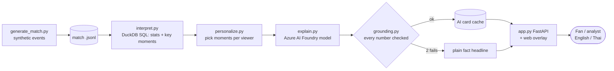

# Match Story

AI match intelligence for synthetic football matches, in English, Thai, Spanish, Arabic, Japanese and Chinese.
Built for the Microsoft + Premier League "Inside the Game" Developer Hackathon (October 2026).

All teams, players, and events are synthetic (made up). No real match data or footage is used.

## Pipeline

| Stage | Status | What it does |
|---|---|---|
| 1. Ingest | done | `src/generate_match.py` creates a synthetic match as a stream of events |
| 2. Interpret | done | `src/interpret.py` turns events into team stats, player stats, a timeline, and key moments (DuckDB SQL) |
| 3. Explain | done | `src/explain.py` asks an Azure AI Foundry model why each key moment matters (fan or analyst, English or Thai). `src/grounding.py` rejects any number the AI did not get from the stats |
| 4. Render | done | `src/app.py` (FastAPI) + `src/static/`: match replay with a live pitch, live stats, momentum chart, and broadcast-style AI cards that pop up on time |
| 5. Personalize | done | `src/personalize.py`: fan or analyst, English or Thai, favorite team, favorite player (with a player card), focus metric. Outputs timed overlay JSON |

## Quick start

```
pip install -r requirements.txt
python src/generate_match.py --seed 7
python src/interpret.py --match data/match_007.jsonl
python src/interpret.py --match data/match_007.jsonl --minute 60   # live view at 60'
python src/explain.py --match data/match_007.jsonl --mode fan --lang en
python src/explain.py --match data/match_007.jsonl --mode analyst --lang th
python src/personalize.py --mode fan --lang th --team rovers
python src/personalize.py --mode analyst --lang en --player demir --focus shooting
python src/app.py        # then open http://127.0.0.1:8000
```

`explain.py` needs a `.env` file (never committed) with `AZURE_AI_ENDPOINT`, `AZURE_AI_KEY`, `AZURE_AI_DEPLOYMENT`.

## The AI agent team

| Agent | Job | Code |
|---|---|---|
| 🧮 Stats agent | Finds key moments with SQL (goals, big chances, saves, momentum, pressing) | `interpret.py` |
| 🎙️ Commentator | Writes the card in the viewer's language and style (Azure AI Foundry) | `explain.py`, `personalize.py` |
| ✅ Fact-checker | Checks every number against the stats; blocks invented numbers | `grounding.py` |
| 🎬 Director | Decides when a card goes on screen: goals at once, others wait for a calm moment, max one pop-up per 30 s | `director.py` |
| 💬 Q&A agent | "Ask the Match": answers viewer questions by choosing SQL tools (overview, player, key moments, time window, pulse and zones), then the fact-checker verifies every number | `ask.py` |

The web page shows their work live in the **AI agent team** log, plus a **Match Pulse** (control vs chaos in the last 5 minutes).

## How the AI stays honest

1. SQL computes every number (`interpret.py`).
2. The AI only gets those numbers, as FACTS.
3. `grounding.py` checks every number the AI writes. Example: FACTS say xG 0.47; "47% chance" passes, "60% chance" is rejected.
4. One retry, then the plain headline is shown instead. The screen never shows an invented stat.

Creates `data/match_007.jsonl`, one event per line, for example:

```json
{"id": 4, "minute": 0, "second": 2, "type": "pass", "team": "Chao Phraya Rovers", "player": "Arthit Kaewmanee",
 "x": 59.9, "y": 30.1, "end_x": 68.0, "end_y": 31.4, "length_m": 8.2, "difficulty": 2.4, "outcome": "complete"}
```

Event types: `match_start`, `kickoff`, `pass`, `pressure`, `tackle`, `interception`, `possession_change`,
`shot`, `save`, `goal`, `foul`, `card`, `half_end`, `match_end`.

Pitch is 105 m x 68 m. Coordinates are from the view of the team on the ball (they attack towards x = 105).

## Architecture



## Deploy to Azure Container Apps

The app runs as one container. Secrets stay out of the image: the AI key is stored as a Container Apps secret.

```powershell
python src/warm_cache.py                      # pre-make AI cards (instant + cheap demo)
az login
az containerapp up --name match-story --resource-group match-story-rg --location southeastasia `
  --source . --ingress external --target-port 8000 `
  --env-vars AZURE_AI_ENDPOINT=<endpoint> AZURE_AI_DEPLOYMENT=match-story-model AI_BUDGET=300
az containerapp secret set -n match-story -g match-story-rg --secrets ai-key=<key>
az containerapp update -n match-story -g match-story-rg --set-env-vars AZURE_AI_KEY=secretref:ai-key `
  --min-replicas 0 --max-replicas 1
```

`AI_BUDGET` caps new AI calls per container start, so a public demo can't run up a bill. Cached cards are always free.
Remove everything afterwards with `az group delete -n match-story-rg`.
